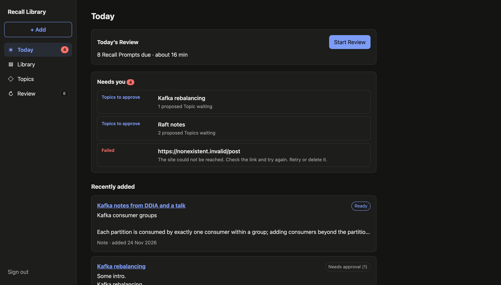
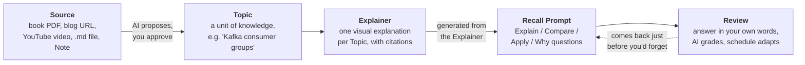
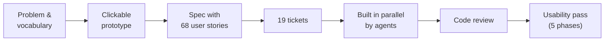
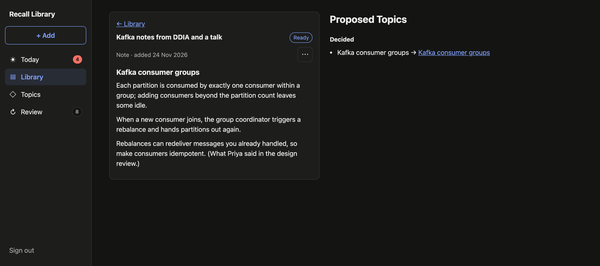
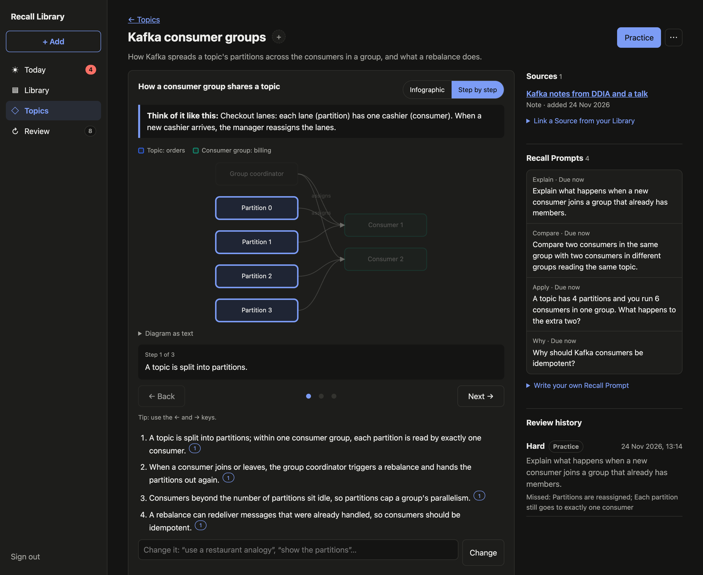
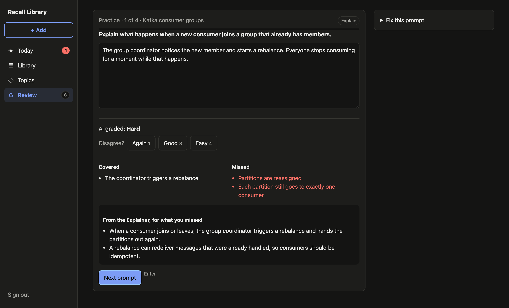
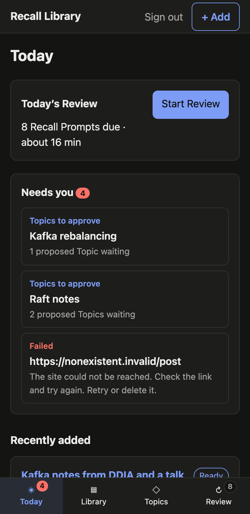
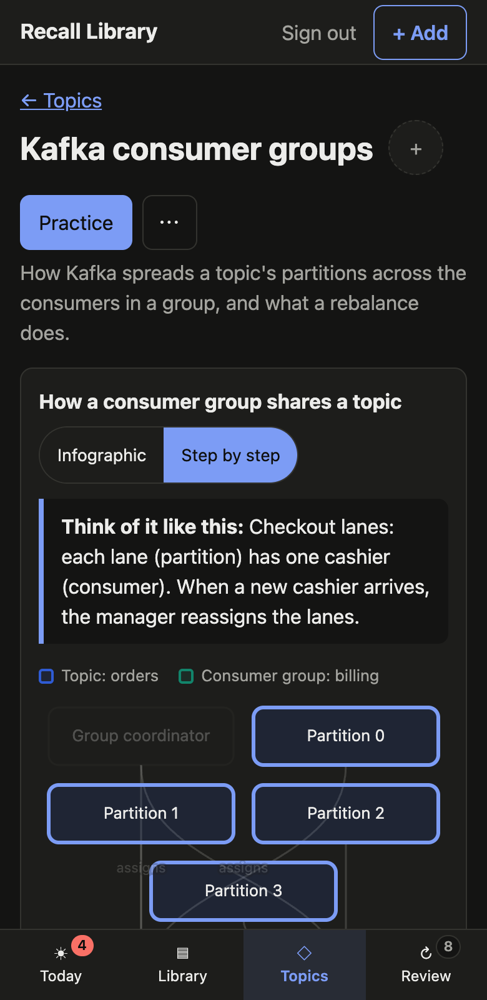
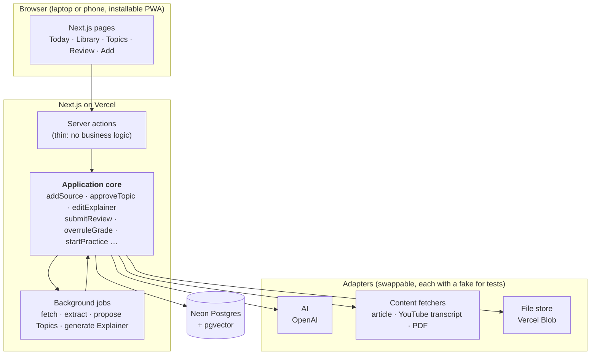

# Recall Library

**A personal learning app that turns what you read and watch into things you actually remember.**

You add a book, a blog post, a YouTube video or a quick note. The app works out which Topics it
covers, draws each Topic as one visual explainer with citations, and then quizzes you on it at
the right times, so it stays in long-term memory instead of fading after a week.



---

## Contents

- [The problem](#the-problem)
- [Who it's for](#who-its-for)
- [The idea in one picture](#the-idea-in-one-picture)
- [How it was built](#how-it-was-built)
- [A walk through the product](#a-walk-through-the-product)
- [User stories](#user-stories)
- [Key product decisions](#key-product-decisions)
- [Architecture](#architecture)
- [Tech stack](#tech-stack)
- [What's next](#whats-next)
- [For developers: run it yourself](#for-developers-run-it-yourself)

---

## The problem

I read books and blogs and watch talks all the time, and a few weeks later most of it is gone.
Re-reading doesn't help much, and the material is scattered: a PDF here, a YouTube link there,
half-remembered blog posts somewhere in my history. When I need what I learned (preparing for an
interview, or recalling something from months ago) I can't get it back.

Existing tools each solve one slice:

| Tool type | What it does well | What's missing |
| --- | --- | --- |
| Read-later and notes apps | Collect content in one place | Nothing makes you remember it |
| Flashcard apps (e.g. Anki) | Spaced repetition works | You write every card by hand, and cards test definitions, not understanding |
| "Chat with your PDF" (RAG) tools | Answer questions about a document | Great for looking things up, no help with remembering; and they regenerate answers every time, so your own corrections are lost |

**Recall Library joins the three:** collect everything in one Library, condense it into something you
understand, then use spaced repetition to keep it.

## Who it's for

One learner (me), using it mostly at a laptop and sometimes on a phone. It is deliberately
single-user: sign-in allows exactly one Google account. That kept the scope honest and let every
decision optimise for one person's learning loop rather than for growth features.

## The idea in one picture

Every piece of content moves through the same five steps:



The words in bold are used consistently in the code, the UI and the docs. They are defined in
[`GLOSSARY.md`](GLOSSARY.md).

## How it was built

This was built as an AI product-management exercise: I acted as the PM and used AI coding agents
(Claude Code) as the engineering team. The process was the interesting part.



1. **Agree the words first.** Before any code, I wrote a [glossary](GLOSSARY.md) (Source, Topic,
   Explainer, Recall Prompt, Review…) with the terms to avoid. This one page removed most of the
   ambiguity between me and the agents, and the same names appear in the UI and the code.
2. **Decide the hard trade-off up front.** The biggest risk was the AI overwriting the learner's
   corrections, so that became [ADR 0001](docs/adr/0001-explainer-is-the-source-of-truth.md)
   before anything was built.
3. **Prototype the flow.** A throwaway clickable prototype compared three app shapes (tab bar,
   single feed, chat) on laptop and phone before committing to one.
4. **Write the spec as user stories.** [Issue #1](https://github.com/sohamthebuilder/recall-library/issues/1)
   holds the problem, 68 user stories, implementation decisions, a testing strategy and an explicit
   out-of-scope list.
5. **Slice into vertical tickets.** The spec became 19 GitHub issues (#2–#20), each a thin slice
   a user could see, starting with a "walking skeleton" (sign in and add a Note) and ending with
   Suggested Edits. Issues use triage labels (`ready-for-agent`, `ready-for-human`…) so it is
   clear who picks each one up.
6. **Build in parallel.** Agents worked on separate tickets at the same time in isolated git
   worktrees, each merging into a shared v1 branch
   ([PR #21](https://github.com/sohamthebuilder/recall-library/pull/21)).
7. **Test behaviour, not internals.** Around 240 automated tests exercise the application core
   against a real (in-process) database with scripted fake AI, e.g. "a new Source on an edited
   Topic produces Suggested Edits, never a new Explainer version".
8. **Review, then use it.** A code-review pass fixed issues across tickets. Then I used the app
   end to end against the user stories ([issue #22](https://github.com/sohamthebuilder/recall-library/issues/22)).
   Almost every story worked, but the app was hard to use: home was six stacked forms, and things
   waiting on me were hidden inside individual pages. That led to a five-phase usability pass
   ([PR #28](https://github.com/sohamthebuilder/recall-library/pull/28)): the Today screen and a
   "Needs you" inbox, a focused Review session, a restructured Topic page, Library tables that
   scale, and a visual system for phone.

**What I'd call out as lessons:**
- *A shared vocabulary is the cheapest spec.* Most agent mistakes came from fuzzy words, not
  fuzzy logic.
- *"Every story is built" is not "usable."* The usability pass was a separate, necessary phase.
- *Design the AI's limits as product features.* Approval steps, overrulable grades and version
  history are what make an AI learning tool trustworthy.

## A walk through the product

*Screenshots are from the running app with the AI replaced by a scripted stand-in, so no API key
is needed. The layout and behaviour are the real product.*

### 1. Today: one screen that says what to do next

The home screen answers three questions: what is due for review (and roughly how long it will
take), what is waiting on me (Topics to approve, failed Sources to retry), and what I added
recently. *(Screenshot at the top of this page.)*

### 2. Add a Source, approve the Topics it covers

I can paste a link, upload a PDF or .md file, or type a Note. The app saves the full text (so
citations still work if the web page disappears), then proposes the Topics the Source covers. It
also checks them against Topics I already have, so the same idea doesn't end up twice. Nothing
enters my Library until I approve, rename, merge or reject it.



For a long book, I pick which chapters to process. This keeps the Library focused and keeps AI
costs down.

### 3. The Explainer: one picture per Topic

Each Topic gets a single Explainer that combines every Source linked to it: a diagram, an analogy,
and key points that each cite the passage they came from. A process becomes a step-by-step
animation; a structure becomes an infographic; I can switch between them.

I can reshape it by instruction ("use a restaurant analogy") or edit the text directly. **My
edited version becomes the source of truth.** Every change is saved as a version I can restore.
Recall Prompts are generated from this Explainer, and they are shown beside it.



### 4. Review: explain it, get graded, see what you missed

A Review asks an open question, not a flashcard. I answer by typing or by speaking (my spoken
answer is transcribed and I can fix it before it's graded). The AI grades the answer against the
Explainer, lists what I covered and what I missed, and shows the relevant part of the Explainer
right there. If the grade feels unfair, I overrule it, and my grade sets the schedule.



Spaced repetition (the FSRS algorithm) decides when each prompt comes back. I can also Practice
any Topic whenever I like; a poor Practice answer brings the prompt back sooner, but a good one
doesn't push it further out, so cramming can't fool the schedule.

### 5. Works on a phone too

Designed for a laptop first, but every feature works at phone width. On Android, the app is
installable and shows up in the Share menu, so a link from the browser or YouTube app goes
straight into the Library.

| Today on a phone | An Explainer on a phone |
| --- | --- |
|  |  |

## User stories

The full v1 spec has 68 user stories (see [issue #1](https://github.com/sohamthebuilder/recall-library/issues/1)).
These are the ones that shaped the product most:

**Capture**
- As the learner, I want to add a blog URL, a YouTube video, a PDF, a .md file or a typed Note, so that everything I learn lives in one Library.
- As the learner, I want the app to keep a copy of each Source's text, so that citations still work if the original page changes or disappears.
- As the learner, I want to choose which chapters of a long book to process, so that I'm not swamped with Topics or charged for chapters I'm not studying yet.
- As the learner on Android, I want the app in my phone's Share menu, so that I can save a link in two taps.

**Understand**
- As the learner, I want Topics proposed from each new Source and matched to Topics I already have, so that I don't have to work out what a Source covers, and the same idea isn't stored twice.
- As the learner, I want one Explainer per Topic that combines all its Sources, so that I study one clear picture rather than several partial ones.
- As the learner, I want every claim in the Explainer to cite its Source passage, so that I can check anything.
- As the learner, I want to edit the Explainer and have my edits change what I'm tested on, so that I'm tested on my own corrected understanding.
- As the learner, I want a new Source to bring *Suggested Edits* rather than rewrite my Explainer, so that my edits are never lost.

**Remember**
- As the learner, I want a home screen showing how many prompts are due and how long they'll take, so that I know what today's revision involves.
- As the learner, I want to answer by speaking or typing and have the AI show me what I missed, so that I learn from every Review.
- As the learner, I want to overrule the AI's grade, with my grade setting the schedule, so that an unfair grade doesn't bring a prompt back at the wrong time.
- As the learner, I want to practise any Topic at any time without cramming tricking the schedule.

## Key product decisions

Some choices were made deliberately, and recorded as short decision records
([`docs/adr/`](docs/adr/)) so the reasoning survives.

**1. The learner's Explainer is the source of truth, not the documents.**
([ADR 0001](docs/adr/0001-explainer-is-the-source-of-truth.md))
The usual "RAG" approach regenerates answers from the documents every time. That would silently
overwrite the learner's corrections, which are the most valuable thing in the Library. So once an
Explainer exists it is never regenerated: new Sources only *suggest* edits, which I accept or
reject one by one. Recall Prompts are generated from the Explainer, so I'm tested on what I
actually agreed to learn.

**2. No AI "general knowledge" in what you study.**
A Topic with no Source gets no Explainer. The app never fills gaps from the model's own knowledge,
so nothing unverified ends up in what I'm tested on.

**3. Understanding over recall of definitions.**
Prompts come in four kinds (Explain, Compare, Apply, Why) and answers are free text or speech, not
multiple choice. The AI grades against specific expected points and shows what was missed.

**4. The human keeps control of the AI.**
I approve every proposed Topic, accept or reject every Suggested Edit, can overrule every grade,
and can restore any earlier version of an Explainer. The AI does the heavy lifting; it never has
the last word.

**5. Keep AI cost modest for one person.**
Chapter selection for books, generation per Topic rather than per whole book, and a small default
model keep running costs low.

**6. Review history follows its Topic.**
([ADR 0002](docs/adr/0002-review-history-follows-its-topic.md)) Deleting a prompt keeps its
history; deleting a Topic removes it. Simple, because v1 has no cross-Topic statistics that would
need the data.

**Deliberately out of scope for v1:** multiple users, deadline-based study Goals, asking questions
across the whole Library ("Ask"), EPUB books, notifications, and export to other tools.

## Architecture



In plain terms:

- **One application core holds all the behaviour.** Its operations are named after the product
  vocabulary (`addSource`, `approveTopic`, `submitReview`…), so a product conversation and the
  code use the same words. The web pages are a thin layer on top.
- **Everything external sits behind a small adapter:** the AI, the content fetchers and the file
  store. Each has a fake version, so the whole product can be tested (and demoed) without network
  calls or an API key. Swapping AI providers later means changing one file.
- **Slow work runs in the background.** Fetching a video transcript or reading a book doesn't
  block the page; each Source shows its status (fetching, extracting, proposing Topics, ready,
  or failed with a reason and a retry).
- **Sources are split into chunks and embedded** (stored as vectors in pgvector). Citations point
  at these chunks, Topic matching uses them, and the future "Ask your Library" feature will search
  them.
- **Explainers are stored as structured data** (diagram nodes, edges, steps, key points,
  citations), never as AI-generated HTML. The app draws them, validates every AI response before
  saving, and keeps every version.

## Tech stack

| Layer | Choice | Why |
| --- | --- | --- |
| App framework | **Next.js** (App Router, TypeScript), React | One codebase for UI and server; server actions keep the UI thin |
| Hosting | **Vercel** | Zero-ops deploys, scheduled jobs, file storage |
| Database | **Neon Postgres** + **pgvector** | Relational data and embeddings in one place; free tier is enough for one user |
| ORM / migrations | **Drizzle** | Typed queries, plain SQL migrations |
| File storage | **Vercel Blob** | Uploaded PDFs (up to 100 MB) go straight from the browser |
| AI | **OpenAI**: `gpt-4.1-mini` (generation, grading), `text-embedding-3-small` (embeddings), `gpt-4o-mini-transcribe` (spoken answers) | Small, cheap models are enough because each call is narrow and its output is validated |
| Spaced repetition | **FSRS** (`ts-fsrs`) | Modern, well-studied scheduling algorithm |
| Content extraction | Mozilla **Readability** (articles), YouTube captions, **unpdf** / PDF.js (books) | Keeps a full-text copy of each Source |
| Auth | **Auth.js** with Google sign-in, one allowed email | No passwords; private on the public internet |
| Validation | **Zod** | Every AI response is checked before it is saved |
| Testing | **Vitest** + **PGlite** (in-process Postgres with pgvector) | Real database in tests, no server or network needed |

## What's next

- **Ask your Library:** questions answered only from my own Sources, with citations, and a clear
  label when an answer isn't from the Library. (Sources are already chunked and embedded for this.)
- **Goals:** a named set of Topics with a deadline ("Interview prep by 15 Dec"), with reviews
  scheduled to peak on that date and an optional daily reminder.
- **EPUB books.**
- **Explainer quality tuning** with real content and a stronger model where it matters.

---

## For developers: run it yourself

### Run the tests

```bash
npm install
npm test          # core tests against an in-process Postgres (PGlite + pgvector); no network
npm run typecheck
npm run build
```

Tests need no database server, no network and no OpenAI key. Each test gets a fresh, fully
migrated PGlite database and deterministic fake adapters (`test/harness.ts`).

### Run the app locally

1. Create a Postgres database with pgvector available (a free Neon project works; so does a local
   Postgres with the `vector` extension installed).
2. Create a Google OAuth client (Web application) with the redirect URI
   `http://localhost:3000/api/auth/callback/google`.
3. `cp .env.example .env.local` and fill in every variable. `LEARNER_EMAIL` is the only Google
   account that can sign in.
4. Apply migrations and start the dev server:

   ```bash
   DATABASE_URL=... npm run db:migrate
   npm run dev
   ```

5. Open http://localhost:3000 and sign in with Google.

### Deploy (Vercel + Neon)

1. Create a Neon project and copy its connection string.
2. Import the repo into Vercel and set `DATABASE_URL`, `AUTH_SECRET`, `AUTH_GOOGLE_ID`,
   `AUTH_GOOGLE_SECRET`, `LEARNER_EMAIL`, `OPENAI_API_KEY` and `CRON_SECRET` in the project's
   environment variables. In the project's Storage tab, create a Blob store and connect it;
   that sets `BLOB_READ_WRITE_TOKEN` (the file store for uploaded files). Optionally set
   `LEARNER_TIME_ZONE` (e.g. `Europe/London`) so the due queue's "today" is yours (default UTC).
3. Add `https://<your-domain>/api/auth/callback/google` as an authorised redirect URI on the
   Google OAuth client.
4. Run `DATABASE_URL=<neon url> npm run db:migrate` once (and after each schema change).
5. Deploy.

### Uploading PDFs (books)

A Vercel function accepts at most a 4.5 MB request body, so .md files go through a server
action but PDFs do not: the browser uploads the PDF straight to Vercel Blob (a *client
upload*, `@vercel/blob/client`), using a short-lived token from `/api/uploads/pdf` (signed-in
learner only, `application/pdf`, up to 100 MB). The form then calls the `addUploadedPdf`
action with the blob's pathname, and the core checks the stored file (it must really be a
PDF) before adding the Source. Locally this needs `BLOB_READ_WRITE_TOKEN` too. The PDF is
read with `unpdf` (PDF.js) in the background job; a very large book is read within one job
run, so keep `maxDuration` in mind on the Hobby plan.

After a PDF is read, its Source page lists its chapters (top-level outline entries, or
20-page ranges when it has no outline). Topics are proposed only from the chapters you
select, one AI call per chapter, and you can select more chapters later.

### Background jobs

Slow work (processing a Source, proposing Topics) runs as background jobs stored in the `jobs`
table. A server action that queues work drains the queue after its response is sent
(`after()` from `next/server`). `vercel.json` also schedules `/api/jobs/run` (protected by
`CRON_SECRET`) once a day as a safety net; on a paid Vercel plan you can make it more frequent.

### Code layout

```
src/core/          application core: operations named after the glossary (the only test seam)
src/core/ports/    adapter interfaces: AI, content fetcher, file store, clock
src/adapters/      adapter implementations; fakes/ holds the deterministic test fakes
src/db/            Drizzle schema, driver-agnostic Db type, production client
src/server/core.ts composition root: the core wired to real adapters (OpenAI in src/adapters/openai.ts)
src/server/jobs.ts runJobsAfterResponse(): drain background jobs after a server action responds
src/app/           Next.js UI: thin pages and server actions that call the core
src/auth.ts        Auth.js configuration
drizzle/           SQL migrations (generated with `npm run db:generate`)
test/harness.ts    createTestCore(): core + fresh PGlite + fakes
docs/adr/          decision records; docs/images/ holds the README screenshots
```
